# ClipCut 🎬

<p align="center">
  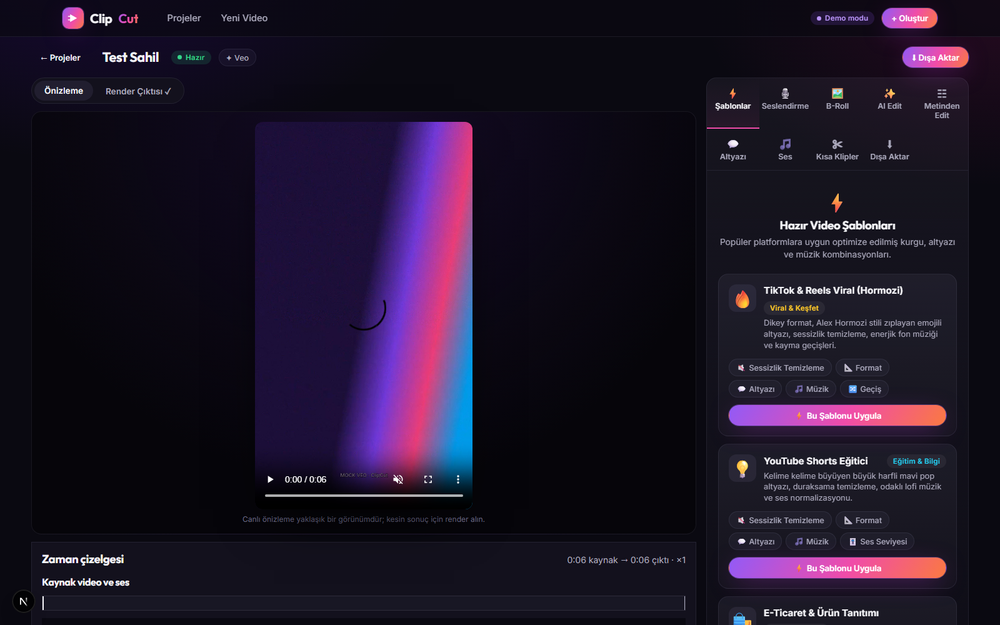
</p>

**ClipCut**, yapay zekâ destekli video üretim ve akıllı edit stüdyosudur: Veo ile prompt'tan video, Gemini ile kelime zamanlamalı altyazı, doğal dil promptu ile otomatik kurgu, çoklu platform dışa aktarma ve uzun videolardan kısa klip çıkarımı — hepsi tek yerel uygulamada.

---

## 🖼 Ekran görüntüleri

Ekranlar, yerel test sağlayıcısıyla çalışan uygulamadan sentetik bir örnek projeyle alınmıştır; gerçek AI üretimi değildir. Örnek projedeki Dünya fotoğrafları NASA arşivindendir (kamu malı).

<p align="center">
  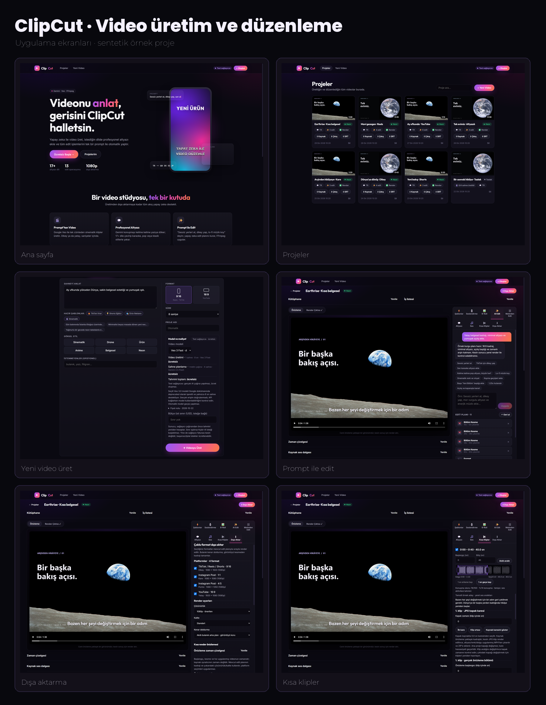
</p>

<details>
<summary>Tek tek büyütmek için (tam boy görüntüler)</summary>

| Panel | Görüntü |
|---|---|
| Ana sayfa | 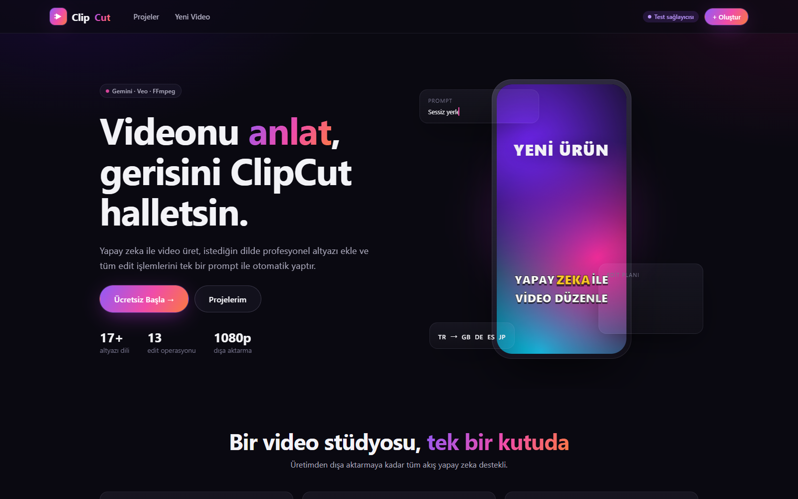 |
| Projeler | 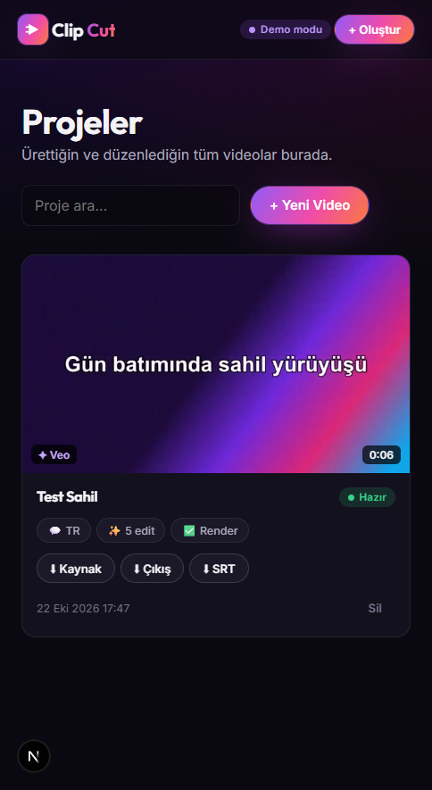 |
| Yeni video üret | 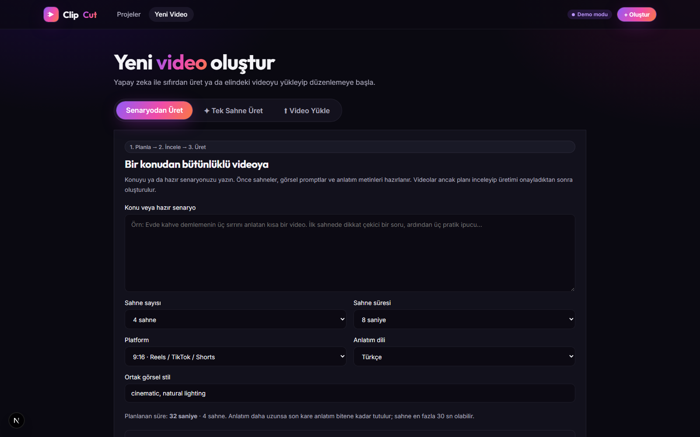 |
| Prompt ile edit | 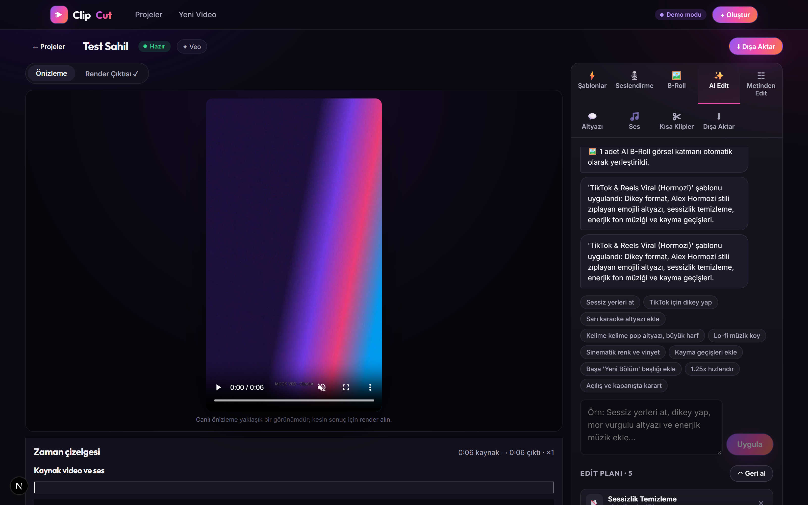 |
| Zaman çizelgesi | 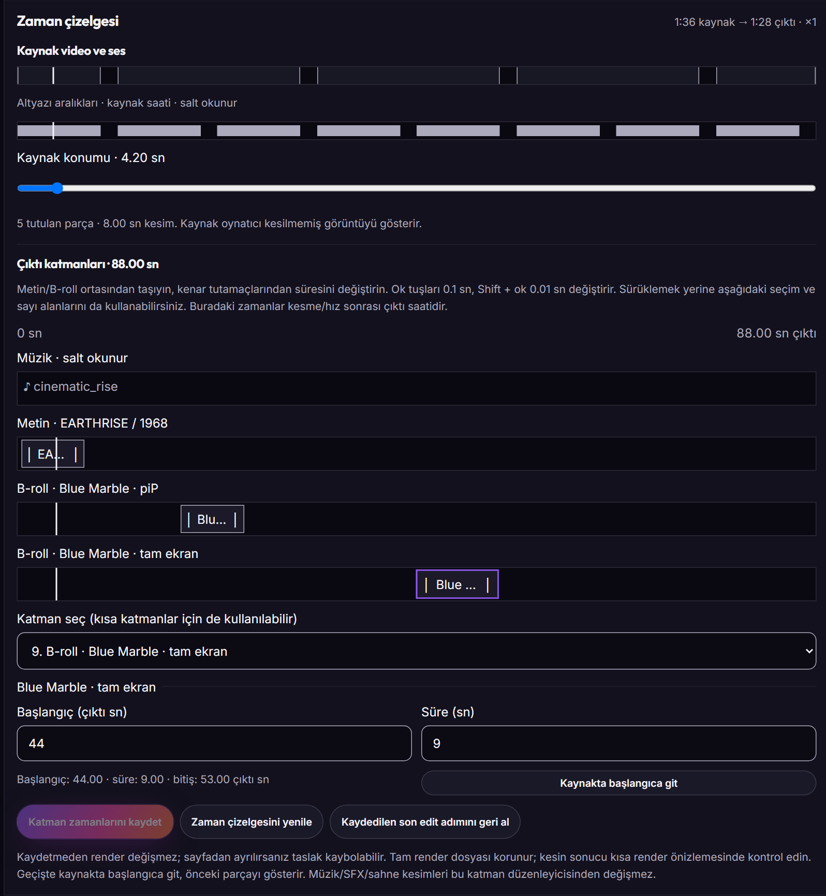 |
| Altyazı stüdyosu | 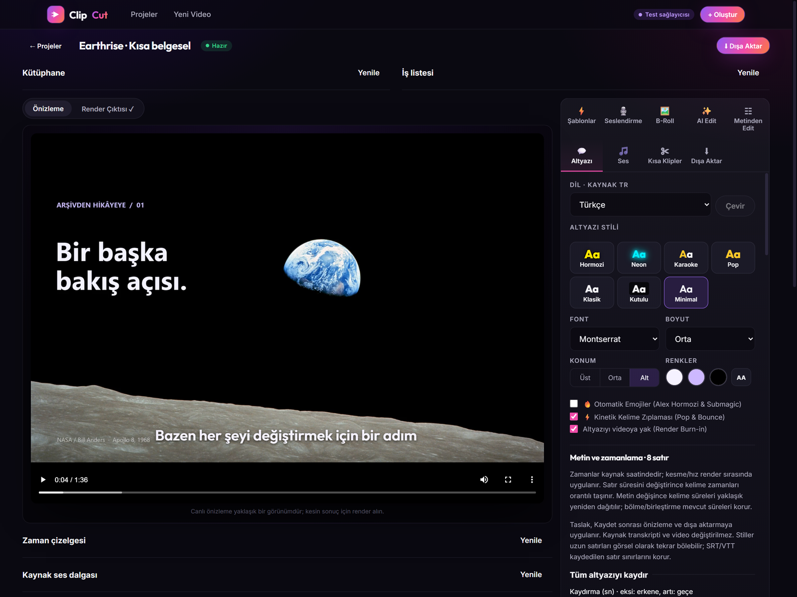 |
| Seslendirme | 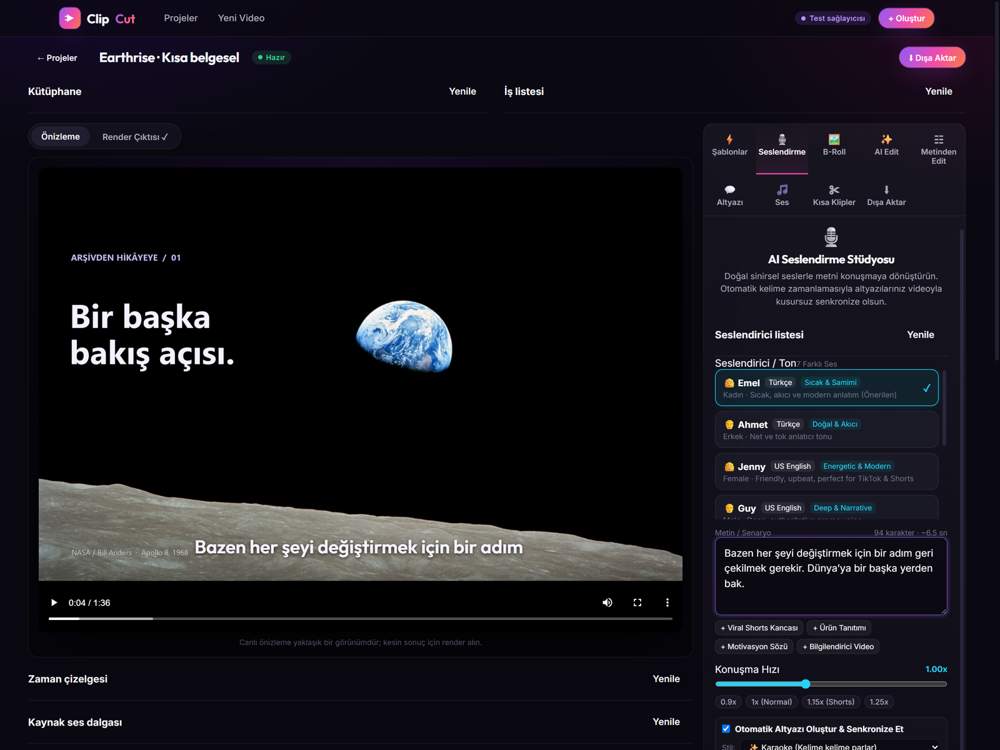 |
| Dışa aktarma | 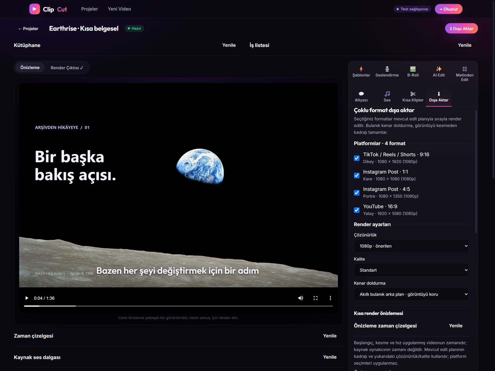 |
| Kısa klipler | 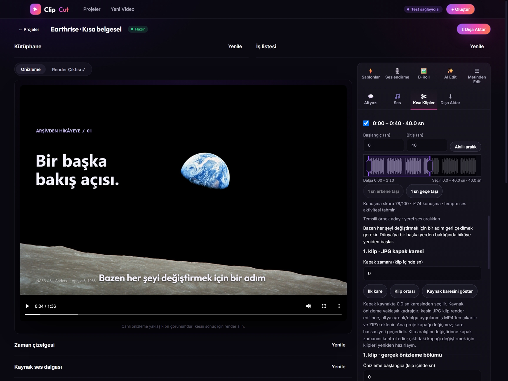 |

</details>

---

## ✨ Öne çıkanlar

- **Prompt ile Video Üret:** Google Veo entegrasyonu ile metinden sinematik video üretimi (9:16 veya 16:9).
- **Otomatik & Çok Dilli Altyazı:** Gemini API ile kelime zaman damgalı transkripsiyon ve 17+ dile çeviri.
- **Canlı Altyazı Stilleri:** TikTok/Reels tarzı kelime vurgulama (Karaoke), pop efekti, klasik sinema, kutulu ve minimal stiller.
- **Altyazı zamanlama editörü:** Altyazı panelinde satır başlangıç/bitişini ve açılır **Kelime zamanları** bölümünde her kelimenin süresini düzenleyin. Kelime arasından satır bölün veya sonraki satırla birleştirin; bu işlemler mevcut kelime zamanlarını korur. Satır süresi değişince kelimeler orantılı taşınır; metin değişince kelime zamanları yaklaşık yeniden dağıtılır. Toplu kaydırmada eksi değer erkene, artı değer geçe taşır; negatif zamana veya medya sınırının dışına çıkan işlem bütünüyle reddedilir. Önizleme ve SRT/VTT için **Metin ve zamanları kaydet** gerekir. Taslak adımları geri alınabilir veya taslak atılabilir; kaydedilmiş altyazı değişiklikleri video-planı geri alma geçmişine eklenmez. Kaynak/transkript/video değişmez, AI çağrısı yapılmaz. Başka bir işlem kaydedilmiş altyazıyı değiştirmişse eski taslak üzerine yazılmaz. SRT/VTT elle belirlenen satır sınırlarını korur; görsel stiller uzun satırları yine kelime gruplarına bölebilir. Zamanlar render öncesi kaynak saatindedir; kesme/hız mevcut motor tarafından eşlenir. Ayrı seslendirme varsa mevcut anlatımın bilinen süresine kadar düzenleme yapılabilir; kaynak videonun ötesindeki altyazılar son videoda görünmeyebilir.
- **Doğal Dil Prompt'u ile Otomatik Edit:** *"Sessiz kısımları sil, dikey yap, sarı karaoke altyazı koy, hafif lofi müzik ekle ve başa 'Yeni Ürün' yaz"* gibi doğal dil komutlarıyla otomatik kurgu planı oluşturma.
- **Deterministik FFmpeg Motoru:** AI doğrudan komut satırı çalıştırmaz; Pydantic ile doğrulanan bir JSON Edit DSL planı üretir, Python motoru bunu güvenli ve hatasız şekilde FFmpeg filtre grafiğine dönüştürür.
- **Gelişmiş Edit İşlemleri:** Sessizlik temizleme (`silencedetect`), yeniden boyutlandırma/reframe (9:16, 1:1, 16:9, blur arka plan), geçiş efektleri (`xfade`), renk filtreleri (`eq`, `lut`), hız değiştirme, ses ducking (`sidechaincompress`), ses efektleri (whoosh, pop, ding) ve animasyonlu başlıklar.
- **Geri Al / İleri Al:** Edit geçmişi sayesinde yapılan her işlem tek tıkla geri alınabilir.
- **Düzenlenebilir zaman çizelgesi:** Üstte kaynak video/altyazı aralıkları ve yerel FFmpeg ile çıkarılan kaynak ses dalgası, altta kesme/hız/geçiş sonrası **çıktı saatinde** metin ve B-roll katmanları görünür. Katmanı ortasından sürükleyerek taşıyın; kenar tutamaçlarından başlangıç/bitişini değiştirin. Ok tuşları 0.1 sn, Shift + ok 0.01 sn değiştirir; kısa katmanlar ve dokunmatik kullanım için katman seçimi + başlangıç/süre sayı alanları da vardır. Değişiklikler taslaktır; **Katman zamanlarını kaydet** tüm değişiklikleri tek edit adımında uygular, mevcut geri alma düğmesi geri alır. Çıktı dışına taşan veya eski plan sürümüne ait değişiklikler reddedilir. Kaynak medya ve son render değiştirilmez, AI/render otomatik başlamaz. Render görünümüne gidip dönmek taslağı korur; sayfadan ayrılmadan önce kaydedin. Kaynakta başlangıca git, çıktı zamanını kesme/hız/geçiş üzerinden kaynağa eşler; geçişte iki görüntü çakıştığında önceki parçayı seçer. Dalga **kaynak sesinin mono tepe genliğidir**, düzenlenmiş müzik/seslendirme karışımı değildir; sessiz ses düz görünebilir, analiz yerel önbelleğe alınır. Müzik, altyazı ve kaynak video kesimleri bu katman düzenleyicisinde salt okunurdur; ilgili panellerden düzenlenir. Kesin çıktı için kısa render önizlemesini kullanın. Geç başlayan B-roll video/fade artık kendi sıfırından başlatılıp çıktı zamanına yerleştirilir; tam ekran katmanlar 0,0'a hizalanır.
- **Metinden Edit:** Editörde kaynak transkript satırlarında arama yapın ve satırları seçin. **Seçili konuşmaları videodan çıkar** görüntü/ses aralıklarını kesim planına ekler; kaynak dosya, transkript ve son render korunur, işlem tek adımda geri alınır. Kaynak oynatıcısı kesilmemiş videoyu gösterir; gerçek sonucu kısa render önizlemesinde kontrol edin. **Seçimden bağımsız klip oluştur** art arda seçilen satırları (aradaki duraklamalarla birlikte) kaynak zamanlarından 9:16 MP4/JPG/ZIP olarak çıkarır. Mevcut yerel klip motoru kullanılır: altyazı/renk stili korunur, ana editin hız/kesim/müzik/zamanlı katmanları klibe taşınmaz. Altyazı çevirisi veya metin düzeltmesi yerine orijinal kaynak transkripti kullanılır. Ayrı seslendirme transkriptleri yanlış kaynak kesimlerini önlemek için engellenir; seslendirmeyi kaldırıp kaynak videoyu yeniden transkribe etmek gerekir. Seçimden sonra kaynak/transkript/edit değişirse işlem reddedilip yeniden seçim istenir. Bu iki işlem AI çağrısı yapmaz; transkript oluşturmak gerçek modda ücretli olabilir. Sentetik test transkriptleri açıkça etiketlenir.
- **Dışa Aktarma:** 1080p MP4 ve ayrıca SRT / VTT altyazı dosyası indirme.
- **Kısa render önizlemesi:** Dışa Aktar panelinde başlangıç saniyesini ve 5/10 sn süreyi seçerek mevcut edit planının gerçek FFmpeg sonucunu izleyin/indirin. Zamanlar kesme ve hız uygulanmış çıktı zamanıdır; video sonunda kalan süre kullanılır. Üstteki çözünürlük ve kalite geçerlidir; çoklu platform seçimleri ve kenar doldurma seçimi uygulanmaz, mevcut planın kadrajı korunur. Tam render dosyası ve edit geçmişi değişmez; AI çağrısı yapılmaz. Sonuç sayfa yenilendiğinde işler listesinden geri gelir; edit veya render ayarları değişirse eski sonuç etiketlenir. Geç bir aralık için önceki karelerin işlenmesi gerekebilir; anlık sonuç garantisi yoktur.
- **Çoklu Platform İhracatı:** Dışa Aktar panelinden TikTok/Reels/Shorts (9:16), Instagram (1:1 ve 4:5), YouTube (16:9) formatlarını seçip tek işte sıralı render alın. Bulanık kenar doldurma, siyah kenar veya merkez kırpma; 720p/1080p/4K ve kalite seçenekleri desteklenir. MP4 ve JPG kapaklar tek tek veya topluca ZIP olarak indirilir.
- **Kapak Karesi Seçici:** Kaynak videoyu oynatıp/sürükleyip proje kapağını kaydedin. Çoklu format render'ında seçilen kaynak zamanı edit zaman çizelgesine eşlenir; kare kesildiyse ilk çıktı karesi kullanılır ve sonuçta belirtilir.
- **Uzun Videodan Kısa Klipler:** Editörde **Kısa Klipler** sekmesinden 30–60 saniye aralığını ve aday sayısını seçin. Yerel FFmpeg sessizlik analizi konuşma yoğunluğunu sıralar. Gerçek kaynak transkripti varsa aday pencereler cümle sınırlarına hizalanır; ilk saniyelerdeki soru/merak/karşıtlık kancası, konuşma temposu ve tekrar eden konu terimleri de yerel olarak puanlanır. Kartlarda akıllı skor, cümle sınırı, açılış kancası ve konu yoğunluğu göstergeleri görünür. Mock transkriptler, seslendirme transkriptleri ve kaynak zamanı doğrulanamayan eski TTS sözcükleri puanlamada kullanılmaz. Adayları önizleyin ve seçtiklerinizi 9:16, 1:1, 4:5 veya 16:9 formatında bağımsız MP4 dosyaları/ZIP olarak çıkarın. Her adayın başlangıç/bitişini dalga formundaki tutamaçları sürükleyerek, odaktayken ok tuşlarıyla (0,1 sn; Shift ile 1 sn), Home/End ile veya 0,1 sn adımlı sayı alanlarıyla ayarlayın. Dalga, seçimin çevresindeki 15–30 sn'lik bağlam penceresini gösterir ve sürükleme sırasında sabit kalır; dokunmatikte tutamaç hedefleri 44 px'e büyür. Sürükleme sırasında Escape veya pointer iptali değişikliği geri alır. Tutamaçlar 30–60 sn ve kaynak sınırları içinde kalır; geçersiz sayı alanı satır içi hata gösterir ve dalga tutamaçlarını devre dışı bırakır. Kaynak transkript varsa 2 sn yakınındaki cümle sınırlarına yapıştırabilir ve seçtiğiniz formatta canlı önizlemede bulanık arka plan, siyah kenar veya merkez kırpma görünümünü izleyebilirsiniz. Dalga kaynak sesin ham mono tepe genliğidir; çizim görünür pencereye göre ölçeklenir, ses düzeyi ölçümü değildir. Canlı önizleme çıktının kadraj/dolgu görünümünü gösterir, kesin sonuç FFmpeg render çıktısıdır. Ayrıca her adayın istediğiniz bölümünü, seçili dolgu ve formatta, altyazı/renk/reframe dahil gerçek FFmpeg ile 5/10 sn'lik MP4 olarak önizleyebilirsiniz; klip sonunda kalan süre kullanılır. Bu dosya tam klip değildir, kaynağı veya tam render çıktısını değiştirmez ve ücretli AI çağrısı yapmaz. Kaynak ses ile altyazı/renk stili korunur; ana editteki hız, kesimler, seslendirme ve zamanlı katmanlar kliplere taşınmaz. Bu özellik ücretli AI çağrısı yapmaz; kanca/konu puanları sezgiseldir, anlamsal önem veya viral başarı garantisi vermez. Müzik/gürültü konuşma gibi algılanabilir. Tamamen sessiz/sessiz ağırlıklı videoda aday bulunmayabilir.
- **Üretim öncesi model ve maliyet kontrolü:** Video ve metin/planlama modelini seçin; bekleyen sahne sayısı, video saniyesi, planlama çağrısı ve Edge TTS çağrıları için **tahmini** sağlayıcı maliyetini görün. İsteğe bağlı USD bütçe üst sınırı, sağlayıcı çağrısından önce sunucuda doğrulanır; tahmini aşan istek hiç başlatılmaz. Model listesi yapılandırılmış varsayılan ve `TEXT_MODEL_OPTIONS`/`VEO_MODEL_OPTIONS` ile sınırlıdır; fiyatı bilinmeyen modelde toplam tahmin üretilmez ve bütçe doğrulanamaz. Tahmin endpoint'i AI çağrısı yapmaz, iş oluşturmaz. Fiyatlar 22 Ekim 2026 liste fiyatı anlık görüntüsüdür; vergi/kur/bölge/çözünürlük ve başarısız istekler dahil değildir, kesin fatura değildir.
- **Sıfır Maliyetli Mock Modu:** `GEMINI_API_KEY` girilmediğinde sistem otomatik olarak mock AI modunda çalışır ve ücret ödemeden tüm akışı test etmenizi sağlar.

### Çalışma biçimi: gerçek AI ve test sağlayıcısı

- **Gerçek mod (üretim):** `backend/.env` dosyasına `GEMINI_API_KEY=...` girildiğinde açık olur. Video üretimi, transkripsiyon ve çeviri ücretli sağlayıcı API'sini kullanır; ücretli her çağrı için arayüzde ayrı onay ister ve istek başına bütçe üst sınırı doğrulanır.
- **Test sağlayıcısı:** Anahtar girilmediğinde mevcut `MOCK_AI=auto` yapılandırması sentetik test çıktıları üretir; gerçek AI video veya konuşma üretmez. Arayüz bu çıktıları açıkça test verisi olarak işaretler. Gerçek üretim için API anahtarı ve sağlayıcıda erişilebilir model gerekir. Videonuzu yükleyerek yerel düzenleme ve FFmpeg dışa aktarmasını AI anahtarı olmadan da kullanabilirsiniz.

### Ana render çıktısının güncelliği

Yeni ana render'lar, işlenmeye başlandığında kullanılan kaynak/edit/altyazı girdilerinin sürümünü saklar. Render sürerken veya sonrasında bu girdiler değişirse sonuç dosyası korunur; editör ve dışa aktarma paneli dosyanın mevcut düzenlemeleri içermediğini belirtir. Güncel MP4 için yeniden render alınmalıdır. Girdileri eski haline döndürmek eşleşmeyi geri getirir; proje adı ve kapak değişiklikleri tek başına render'ı eskimiş saymaz. Sürüm bilgisi olmayan eski çıktılar güncel kabul edilmez. Bu kontrol girdileri karşılaştırır, diskteki dosyanın bütünlüğünü veya seçili çözünürlük/kaliteye uygunluğunu doğrulamaz.

### AI bağlantısı, son kontrol ve hata yönlendirmesi

**Yeni Video → AI bağlantısı** paneli, anahtarın sunucuda tanımlı olup olmadığını ve yapılandırılmış metin, transkripsiyon ve video modellerini gösterir; anahtarın kendisini tarayıcıya göndermez. Sayfa açılışı yalnızca yerel yapılandırmayı okur. **Üretim yapmadan bağlantıyı kontrol et** düğmesi, gerçek sağlayıcı etkinse Google üzerinden model bilgilerini sorgular; prompt, medya, video üretimi veya TTS göndermez. Test sağlayıcısında ya da anahtar yokken dış sorgu yapılmaz. Model bilgisine erişim; üretim yetkisi, kota, faturalandırma veya başarılı içerik üretimi garantisi değildir. Kontrol sonucu kalıcı sertifika gibi saklanmaz; sayfa yeniden açılınca durum yeniden kontrol edilmemiş olarak gösterilir.

Tek sahne, sahne planlama ve storyboard üretimi öncesinde güncel tahmin yeniden alınır; model kimlikleri, çağrı sayısı, video saniyesi, tahmini tutar ve varsa bütçe sınırı son onayda gösterilir. Storyboard için kalan sahneleri sunucu hazır dosyalara göre belirler. Onayı iptal etmek üretim isteğini göndermez. Gerçek tek-sahne üretiminde de sunucu açık API kullanım onayı ister; test ve yerel birleştirme için ücretli üretim onayı açılmaz. Tahmin kesin fatura değildir; istek başına bütçe doğrulaması mevcut sunucu denetimini kullanır.

Gemini/Veo çağrılarındaki geçersiz anahtar, izin, model/kaynak erişimi, kota ve bağlantı hataları için neyin kontrol edilmesi gerektiği açıklanır. Bu yollarda ham SDK hata yükleri kullanıcıya aktarılmaz; başarısız üretim otomatik tekrar edilmez. Sağlayıcıda başlamış bir isteği yeniden göndermek ek ücret doğurabilir. Bu sınıflandırma Gemini/Veo yolları içindir; Edge TTS ayrı hata davranışını korur.

### Kısa klip aralığını taşıma

Klip adayının dalga formunda aralığın ortasını sürükleyerek başlangıç ve bitişi birlikte taşıyın; klibin süresi değişmez. Odaklanan aralıkta ok tuşları 0,1 sn, Shift + ok 1 sn; Home/End kaynak başına/sonuna taşır. **1 sn erkene taşı / 1 sn geçe taşı** düğmeleri sürükleme alternatifidir. Kaynak sınırında hareket kalan mesafeyle sınırlanır; sürükleme sırasında görünür dalga penceresi sabit kalır ve aralık bu pencerenin içinde tutulur. Daha uzağa gitmek için klavye veya düğmeleri kullanın. Escape, pointer iptali veya pointer capture kaybı sürüklemeyi geri alır.

Taşıma sırasında süreyi korumak için cümleye yapıştırma uygulanmaz; kenar tutamaçlarında mevcut yapıştırma davranışı sürer. Önizleme ve dışa aktarma yeni aralığı kullanır; önceki gerçek render önizlemesi eskimiş olarak işaretlenir, otomatik yeniden render yapılmaz. Bu işlem kaynak videoyu veya ana edit planını değiştirmez ve AI çağrısı yapmaz.

**Otomatik yerel taslak:** Geçerli klip aralıkları, seçili klipler, cümleye yapıştırma, çıktı formatı ve çözünürlük/kalite/dolgu ayarları projeye özel olarak bu tarayıcının `localStorage` alanına kaydedilir; paneli veya sayfayı yeniden açınca geri gelir. Kaynak adresi/süresi/ses bilgisi, analiz kimliği veya aday aralıkları değişmişse eski taslak uygulanmaz. Bozuk veya desteklenmeyen kayıtlar da reddedilir. Geçersiz düzenleme son geçerli taslağın üzerine yazılmaz; depolama kapalı/doluysa uyarı gösterilir ve düzenleme oturum içinde devam eder. **Taslağı sıfırla**, adayların ilk aralıklarını, boş seçimi, 9:16 formatını ve varsayılan çıktı ayarlarını geri getirip saklar. Bu kayıt sunucuya veya başka cihaza senkronize edilmez; tarayıcı verilerini silmek taslağı siler. Birden fazla sekmede aynı projeyi düzenlemek için çakışma çözümü yoktur; son başarılı kayıt geçerlidir. Analiz arama parametreleri ve oynatıcı konumu saklanmaz.

**Klip aralıklarında geri al / ileri al:** Klip panelindeki **Aralık geri al / Aralık ileri al** düğmeleri son 30 tamamlanmış zaman değişikliğini geri getirir. Sürükleme tek adımdır; ok tuşu, taşı düğmesi veya **Akıllı aralık** değişikliği birer adım, sayı girişi ise alandan çıkınca tamamlanan bir adımdır. İptal edilen sürükleme veya değişiklik yapmayan işlem geçmiş eklemez. Geçersiz/tamamlanmamış sayı girişinde geri al önce son tamamlanan aralıkları geri getirir; yeni tamamlanan değişiklik ileri alma kolunu temizler. Seçili klipler, yapıştırma ve çıktı ayarları bu geri almadan etkilenmez; ana video edit geçmişi ve kaynak medya değişmez. Son aralıklar otomatik saklanır, ancak geri alma geçmişi yalnızca panel oturumundadır: panel/sayfa yeniden açıldığında, kaynak/analiz değiştiğinde ve **Taslağı sıfırla** ile temizlenir. Sıfırlama geri alınamaz. Sürükleme sırasında geçmiş düğmeleri devre dışıdır; önce sürüklemeyi tamamlayın veya Escape ile iptal edin.

### Klip içinde gerçek render önizlemesi

Her adayın **Önizleme başlangıcı (klip içinde sn)** alanı, seçilen klibin sıfırından itibaren sayılır: kaynakta 40–75 sn olan bir klipte başlangıç 20 seçmek, kaynakta 60. saniyeden önizleme demektir. Süreyi **5 veya 10 saniye** seçin; **Klip başı / Son 5–10 sn** düğmeleri konumu hızlı ayarlar. Render yalnızca **Gerçek 5/10 sn önizle** düğmesine basılınca başlar. Kaynak/klip aralığı ve render ayarları değişmez; klip sonunda kalan süre kullanılır ve en az 0,1 sn kalmalıdır. Geçersiz başlangıçta düğme kapatılır; sunucu da iş oluşturmadan isteği reddeder.

Sonuçta klip içi bölüm, kaynak zamanı ve istenen/gerçek süre ayrı gösterilir. Bölüm başlangıcı/süresi, tam klip aralığı, format, dolgu/kalite/çözünürlük veya render girdileri değişirse eski sonuç işaretlenir; otomatik yeniden render yapılmaz. Sayfa yenilenince son iş sonucu ve onun bölüm seçimi geri gelir; diğer kaydedilmemiş bölüm seçimleri yerel taslağa eklenmez. **Taslağı sıfırla**, bölüm kontrollerini de 0 sn / 5 sn'ye döndürür.

Motor tam klibin filtre grafiğini koruyup yalnızca seçilen çıktı penceresini kodlar; bu sayede geç altyazılar doğru zamanda kalır. Geç bir bölümün hazırlanması önceki karelerin işlenmesini gerektirebilir; anlık sonuç garantisi yoktur. Önizleme dosyaları mevcut saklama davranışını izler, otomatik temizlik yoktur. Ücretli AI/TTS çağrısı yapılmaz.

### Kısa klip kapağı (JPG)

Her adayın **Kapak zamanı (klip içinde sn)** değeri klibin başlangıcına göre 0 ile (klip süresi − 0,1 sn) arasında seçilir. **İlk kare** ve **Klip ortası** hızlı seçenekleri, **Kaynak karesini göster** ise duraklatılmış yaklaşık kadraj önizlemesi sunar. Kesin JPG, klipler hazırlanırken altyazı/renk/reframe/dolgu uygulanmış ve seçili formatta üretilmiş MP4'ten çıkarılır ve ZIP'e MP4 ile birlikte eklenir. Ana projenin kapağı ve kaynak medya değişmez.

Kapak zamanı klip aralığına göre saklanır. Klip kısaltılınca kapak yeni bitişin ötesinde kalırsa sessizce taşınmaz; satır içi hata gösterilir ve **Klipleri hazırla** kapatılır. Sunucu da geçersiz veya eksik kapak eşleşmelerini iş oluşturmadan reddeder. Eski taslaklar kapak 0 kabul edilerek açılır; **Taslağı sıfırla** kapakları da ilk kareye döndürür. Kapak seçimi ücretli AI çağrısı yapmaz; kare zamanı kare hassasiyetindedir, ancak geç karelerin hazırlanması render süresini artırabilir.

### Kısa klip çıktı formatları

**Kısa klip çıktı formatları** seçicisi tüm seçili kliplere uygulanır: TikTok/Reels/Shorts için **9:16**, Instagram kare için **1:1**, Instagram portre için **4:5**, YouTube/yatay için **16:9**. Varsayılan 9:16'dır. Birden fazla format işaretlenebilir; her seçili klip için her formatta ayrı MP4 ve JPG üretilir ve ZIP tüm dosyaları içerir. Son seçili format kaldırılamaz. Format sayısı arttıkça render süresi de artar. Seçim MP4/JPG boyutlarına ve ZIP içindeki `clip_01_instagram_square` gibi platforma özel dosya adlarına yansır. Ana projenin çıktı formatı ve kaynak medya değişmez.

**Önizleme formatı** alanı, seçili çıktı formatları arasında canlı ve gerçek FFmpeg önizlemesinin kadrajını değiştirir. Yalnızca önizleme formatını değiştirmek çıktı listesini/sırasını veya hazır MP4/JPG/ZIP dosyalarının güncelliğini etkilemez. Önceki gerçek önizleme farklı formattaysa eskimiş uyarısı gösterilir; yeni önizleme yalnızca düğmeyle hazırlanır. Önizlenen format çıktı listesinden kaldırılırsa ilk kalan format kullanılır.

Çıktı ve önizleme formatı seçimleri yerel taslakta saklanır ve sayfa yenilenince geri gelir; eski taslaklar tek `aspect` değerini tek formatlı seçime taşır, önizleme formatı olmayan taslaklar ilk seçili formatla açılır. **Taslağı sıfırla** iki seçimi de 9:16'ya döndürür. Çıktı formatı listesi değişince hazır klip dosyaları güncel değil olarak işaretlenir; MP4/JPG/ZIP dosyalarını güncellemek için **Klipleri hazırla** yeniden çalıştırılmalıdır. Otomatik render veya ücretli AI/TTS çağrısı yapılmaz. Yatay kaynakta 9:16 gibi dikey çıktılar seçili dolgu moduna göre kırpılır, bulanık arka planla doldurulur veya siyah kenarlı kalır.

### Hazır klip dosyalarının güncelliği

Klipler hazırlanırken seçilen sıra, aralıklar, kapak zamanları, format listesi, dolgu, çözünürlük/kalite ve proje render revizyonu sonuçla birlikte saklanır. Bu değerlerden biri değişince **Dosyalar hazır** bölümünde “son hazırlanan dosyalardan farklı” uyarısı görünür; indirme bağlantıları korunur, ancak güncel çıktı için **Klipleri hazırla** yeniden çalıştırılmalıdır. Değişiklik geri alınırsa uyarı kendiliğinden kalkar. Sayfa yenilense veya başka bir panel açılsa da sonuç özeti sayesinde durum korunur.

Bu özellikten önce hazırlanmış sonuçlarda istek özeti yoktur; bunlar yanlışlıkla “güncel” sayılmaz ve “güncellik bilgisi olmadan hazırlandı” uyarısı gösterir. Tek formatlı eski sonuçlar, seçim hâlâ o tek formatla eşleşiyorsa güncel kalabilir. Otomatik yeniden render yapılmaz. Uyarı yalnızca kısa klip sonuçlarına aittir; ana proje renderı, kaynak medya veya edit geçmişi değişmez.

### Hazır çıktıları kontrollü oynatma

Klip, transkript klibi ve toplu dışa aktarma sonuçlarında **Oynatıcıyı aç** düğmesi son hazırlanan MP4 dosyasını gösterir. Başlangıçta yalnızca kapaklar vardır; MP4, oynatıcı açılmadan yüklenmez ve otomatik oynatılmaz. Panelde başka bir sonuç açılınca önceki oynatıcı kaldırılır ve oynatma durur. **Oynatıcıyı kapat** ile kapağa dönülür. Yükleme/oynatma hatasında açıklama ve **Oynatmayı yeniden dene** düğmesi görünür; MP4, JPG ve ZIP indirme bağlantıları korunur. Yeni render sonucu eski açık oynatıcıyı devralmaz.

Oynatılan video son render dosyasıdır; henüz render edilmemiş düzenlemeleri içermez. Kısa kliplerdeki güncellik uyarısı oynatıcı açıkken de korunur. Oynatıcı seçimi sayfa yenilenince sıfırlanır; kaynak medya ve ana proje değiştirilmez.

Birden fazla format içeren sonuçlarda **Gösterilen format** alanıyla listeyi 9:16, 1:1 gibi bir formata daraltabilirsiniz. Seçeneklerde format başına çıktı sayısı, listenin üstünde gösterilen/toplam çıktı sayısı yer alır. Filtre yalnızca görünümü değiştirir: çıktı sırası, render ayarları ve güncellik uyarısı korunur; **Tümünü ZIP olarak indir** her zaman bütün çıktıları indirir. Filtre değişince açık oynatıcı kapanır. **Tüm formatlar** seçimi listeyi geri getirir; yeni render sonucu veya sayfa açılışı tüm formatlarla başlar. Tek formatlı sonuçlarda gereksiz filtre gösterilmez.

Yeni hazırlanan çok formatlı sonuçlarda, bir format seçildiğinde **Yalnızca 1:1 ZIP indir** gibi ek bir bağlantı görünür. Bu ZIP yalnızca seçilen formattaki bütün MP4/JPG çiftlerini içerir; tüm çıktıları içeren ZIP bağlantısı değişmez. Format arşivleri render edilen dosyalardan aynı iş içinde hazırlanır, ek video renderı veya AI çağrısı yapılmaz. Tek formatlı işlerde mevcut tam ZIP yeniden kullanılır. Çok formatlı işlerde ek ZIP dosyaları disk alanı kullanır; otomatik temizleme yoktur.

Eski sonuçlarda format arşivi bilgisi bulunmayabilir. Bu durumda yanlış içerikli bir indirme sunulmaz; açıklama ile mevcut MP4/JPG ve tam ZIP bağlantıları korunur. Ayrı format ZIP'leri yalnızca yeni hazırlanan sonuçlarda mevcuttur; otomatik yeniden render yapılmaz.

### Klip bazlı sonuç grupları

Yeni hazırlanan kısa klip ve transkript klibi sonuçları **Klip 1**, **Klip 2** şeklinde, render için seçilen sırayla gruplanır. Her grubun kaynak aralığı ve bir çıktı kartı gösterilir. Gruptaki **9:16**, **1:1** gibi düğmeler yalnızca o klibin görünen formatını değiştirir; başka kliplerin seçimi ve dosyaların güncelliği değişmez. Format değiştirmek açık oynatıcıyı kapatır, yeni video otomatik başlamaz. Üstteki format filtresi gruplarda incelenebilecek formatları daraltır; sayaç filtreyle eşleşen toplam çıktı sayısını belirtir.

**Klip 1 · tüm formatları ZIP indir** bağlantısı, görünümdeki format ve üstteki filtreden bağımsız olarak yalnızca o klibin bütün MP4/JPG çiftlerini indirir. **Tümünü ZIP** ve format bazlı ZIP bağlantıları da korunur. Arşivler aynı render işinde hazır dosyalardan oluşturulur; ek render yapılmaz. Tek klipli işlerde tam ZIP yeniden kullanılır; çok klipli işlerde klip ZIP'leri ilave disk alanı kullanır.

Eski sonuçlarda açık klip metadata'sı yoksa dosya adından tahmin yapılmaz; çıktılar mevcut düz listede ve indirme bağlantılarıyla gösterilir. Toplu ana video dışa aktarımları da düz liste olarak kalır. Grup içi format tercihleri yalnızca açık panel oturumundadır; yeni sonuç veya sayfa açılışında ilk uygun format gösterilir. Kaynak video, proje planı ve edit geçmişi değişmez.

Analizle üretilmiş bir klip grubu hâlâ mevcut analizin adayına güvenle eşleşiyorsa **Klibi düzenle** düğmesi görünür. Düğme açık sonuç oynatıcısını kapatır ve ilgili adayın başlangıç zamanı alanına götürür. Eşleştirme son render'ın klip kimliklerini kullanır; sonradan seçim sırasını değiştirmeniz yanlış klibe gitmesine neden olmaz. Mevcut zaman değişiklikleri korunur, render sırasında kullanılan eski aralık geri yüklenmez ve yeni iş başlatılmaz. Analiz değişmişse, aday artık yoksa veya eşleştirme metadata'sı eksikse düğme sunulmaz. Transkript klibi ve toplu dışa aktarma sonuçlarına bu kısa-klip düzenleme bağlantısı eklenmez.

Taslak zamanları son çıktıdan farklıysa, güvenle eşleşen grupta **Son render aralığına dön** işlemi son render ve mevcut taslak zamanlarını karşılaştırır. Yalnızca aynı analiz ve proje render revizyonunda, kaynak sınırlarına uyan 30–60 saniyelik eski aralık geri getirilebilir. İşlem sadece o klibin başlangıç/bitişini değiştirir, oynatıcıyı kapatır ve zaman alanına odaklanır. Seçimler, kapaklar, formatlar, dolgu ve kalite değişmez; yeni render başlamaz. **Aralık geri al / ileri al** ile zamanlar tekrar değiştirilebilir. Geçerli bekleyen sayı girişi önce tamamlanır; geri yükleme ayrı bir aralık adımıdır. Geçersiz girişler geçmişe yazılmaz. Başka bir klibin aralığı geçersizse önce o girişi düzeltin.

Geri getirilen aralık kapak zamanını dışarıda bırakırsa kapak otomatik taşınmaz: hata gösterilir ve render engellenir. Kapak düzeltilene veya aralık geri alınana kadar mevcut taslak doğrulama kuralları son geçerli kayıtlı taslağı korur. Eski/eşleşmeyen analiz veya proje revizyonunda otomatik aralık tahmini yapılmaz; elle düzenleme ve indirme bağlantıları kullanılabilir.

### Yalnızca değişen klip çıktılarını hazırlama

Bir kısa klip sonucu hazır olduğunda **Yalnızca değişenleri hazırla** düğmesi önceki sonucu kullanarak yeni seçimin tamamını paketler. Adaylarda ve sonuç gruplarında **Girdiler aynı / Yalnızca kapak yenilenecek / Yeniden hazırlanmalı / Doğrulanamıyor** durumu gösterilir. Bu, istek girdilerinin karşılaştırmasıdır; dosyaların gerçekten mevcut ve değişmemiş olduğu sunucuda ayrıca doğrulanır. Normal **Klipleri hazırla** düğmesi bütün seçili çıktıları yeniden render etmeye devam eder.

Sunucu yalnızca aynı projeye ait tamamlanmış bir kısa klip işini temel alır. Analiz, proje render revizyonu, kaynak dosyanın SHA-256 hash'i, klip kimliği/aralığı, format, dolgu, çözünürlük ve kalite eşleşmelidir. Önceki MP4'ün kayıtlı hash'i doğrulanır; JPG ayrıca kapak zamanı ve kendi hash'i ile doğrulanır. Eşleşen dosyalar yeni işin klasörüne **kopyalanır**; eski dosyalar değiştirilmez veya hardlink ile bağlanmaz. Eksik, değiştirilmiş ya da doğrulanamayan MP4 yeniden render edilir. Kaynak dosya okunup doğrulanamıyorsa render başlamadan hata verir. Kaynak işlem sırasında değişirse karışık bir sonuç yayınlanmaz; iş hata verir.

Bir klibin aralığı değişirse yalnızca onun istenen formatlarındaki MP4/JPG çiftleri yeniden üretilir. Yalnızca kapak zamanı değişirse doğrulanan MP4 kopyalanır ve yalnızca o formatların JPG kapağı yeni kareden oluşturulur; video render edilmez. Aynı şekilde JPG eksik veya bozuksa doğrulanan MP4 korunup JPG yeniden çıkarılır. Yeni formatlar ve klipler hazırlanır, kaldırılanlar yeni pakete alınmaz. Sadece klip/format sırasını değiştirmek aynı girdideki dosyaları yeniden render ettirmez; yeni dosya adları ve istek özeti yeni sırayı izler. Dolgu, kalite, çözünürlük, analiz veya proje revizyonu değişirse güvenli biçimde yeniden render yapılır. Tam, format bazlı ve klip bazlı ZIP'ler yeni seçimin bütün dosyalarından yeniden oluşturulur.

Sonuçtaki **1 çıktı korundu · 1 kapak yenilendi · 2 çıktı yeniden hazırlandı** gibi sayaçlar format çıktılarını sayar; korunan ve yalnızca kapağı yenilenen kartlar ayrıca işaretlenir. Eski sonuçlarda kaynak/çıktı hash bilgisi yoksa ilk işlem bütün gerekli MP4'leri yeniden üretir. İşlem otomatik başlamaz ve ücretli AI/TTS çağrısı yapmaz. Amaç render süresini azaltmaktır: hash kontrolü, kopyalama, tek kare çıkarma ve ZIP hazırlama yine zaman/disk alanı kullanır; otomatik dosya temizleme yapılmaz. Bu özellik analiz tabanlı kısa klipler içindir; ana video toplu dışa aktarımı ve transkript klipleri mevcut tam-render davranışını korur.

### Depolama kullanımı, çöp kutusu ve güvenli temizlik

**Kısa Klipler** ve **Dışa Aktar** panellerindeki **Depolama** bölümünde **Depolamayı tara** düğmesi projenin disk kullanımını **Kaynak medya**, **Ana render MP4'leri**, **Hazırlama çıktıları**, **Önizlemeler**, **work/ ara dosyaları**, **Çöp kutusu** ve varsa **Diğer proje dosyaları** olarak özetler; toplam kullanımı, çöpe taşınabilecek alanı ve çöpte bekleyen alanı ayrı gösterir. Kaynak medya satırı kaynak videoyu, seslendirmeyi ve kapağı kapsar. Tarama otomatik başlamaz.

**Eski çıktıları temizle** yalnızca `outputs/<32-karakter iş kimliği>` biçimindeki hazırlama klasörlerinden hiçbir kayıtlı iş sonucunda adresi geçmeyen, en az 1 saat önce oluşturulmuş ve içinde yalnızca normal dosyalar bulunanları çöp kutusuna taşır. İş sonuçlarında kullanılan klasörler, yeni oluşturulmuş klasörler ve güvenlik denetiminden geçmeyen (sembolik bağlantı, alt klasör, özel dosya veya okunamayan) klasörler korunur.

**Eski ana render'ları temizle** yalnızca doğrudan `outputs/` altındaki `clipcut_*.mp4` dosyalarından projenin güncel çıktısı olmayan, proje durumunda veya başka bir iş sonucunda kullanılmayan ve en az 1 saat önce oluşturulmuş olanları çöp kutusuna taşır. Bir render işinin kendi sonucu, dosyanın üretim kaydı olarak değerlendirilir ve tek başına koruma nedeni sayılmaz; güncel `output_file`, storyboard sürümlerindeki çıktılar ve hazırlama/toplama iş sonuçları korunur.

**Tek tek seçerek temizle** aynı panelde uygun hazırlama klasörlerini, ana render MP4'lerini, çalışma klasörlerini, önizlemeleri ve seslendirme dosyalarını satır satır listeler. Her satır bir onay kutusudur; **Tümünü seç / Seçimi temizle** ve seçilen öğe sayısı/boyutu görünür. **Seçilenleri çöpe taşı** yalnızca işaretlenenleri taşır; 50'lik istek sınırı istemci tarafından parçalanır. Hiçbir öğe varsayılan olarak seçili değildir; yeni tarama veya taşıma sonrası seçim sıfırlanır.

**Çalışma klasörlerini temizle** `work/` altındaki üretilmiş ara klasörleri kapsar: `work/<zaman-damgası>`, `work/<yayın-kimliği>` (iç içe klip klasörleri dahil), `work/previews/<kimlik>`, `work/clip_previews/<kimlik>` ve `work/waveforms` önbelleği. Yalnızca en az 1 saat önce oluşturulmuş, sembolik bağlantı/özel dosya içermeyen ve süren render, önizleme veya hazırlama işi bulunmayan klasörler çöpe taşınır. Dalga formu önbelleği silinirse bir sonraki açılışta yeniden üretilir. Geri alma özgün `work/...` yoluna yapılır; kaynak video, güncel render/önizlemeler ve proje verisi değişmez.

**Eski önizlemeleri temizle** yalnızca `outputs/previews/<32-karakter kimlik>.mp4` ve `outputs/clip_previews/<32-karakter kimlik>.mp4` dosyalarını kapsar. Normal ve klip önizlemesi için **en güncel tamamlanmış önizleme sonucu** korunur; daha eski önizleme iş sonuçları yalnızca üretim kaydı sayılır ve tek başına koruma nedeni olmaz. En az 1 saat yaş, symlink/özel dosya denetimi ve süren önizleme işi kontrolü uygulanır. Geri alma özgün `outputs/previews` veya `outputs/clip_previews` yoluna yapılır.

**Eski seslendirmeleri temizle** proje kökündeki `voiceover_<32-karakter kimlik>.mp3` dosyalarını kapsar. Güncel seslendirme, proje planı/storyboard sürümleri ve herhangi bir iş sonucunda adı geçen dosyalar korunur; yalnızca en az 1 saat önce oluşturulmuş, artık hiçbir kayıtta kullanılmayan (örneğin revizyon çakışmasıyla projeye bağlanmamış) dosyalar çöpe taşınır. Seslendirme önizleme denemeleri `storage/temp/preview_<8-karakter kimlik>.mp3` olarak yazılır ve **24 saatten eski** olanlar sunucu açılışında sessizce silinir; bu dosyalar proje çöp kutusuna girmez ve geri alınamaz.

Temizlik hemen silmez: taşınan öğeler proje içindeki `.trash` klasöründe **7 gün** tutulur. Çöp kutusu öğeleri son temizlik gruplarına göre listeler; her grupta toplam boyut, her öğede kalan süre ve **Bu grubu geri al** düğmesi bulunur. Öğeler tek tek veya **Tümünü geri al** ile eski konumuna döndürülebilir; özgün yol doluysa üzerine yazılmaz. **Çöp kutusunu boşalt** kalıcı siler ve geri alınamaz. Süresi dolan öğeler sunucu açılışında ve bir sonraki depolama taramasında otomatik temizlenir; ayrı bir zamanlayıcı yoktur. `.trash` içeriği medya URL'siyle sunulmaz.

Her temizlik onay ister ve yalnızca taramada gösterilen öğeleri taşır. Sunucu işlemden önce proje durumunu ve bütün iş sonuçlarını yeniden tarar; bu arada bir öğe korumaya alınmışsa taşınmaz. Süren bir render, önizleme veya hazırlama işi varsa ana render, work/ ve önizleme temizliği yapılmaz. Kaynak video, seslendirme, proje kapağı, güncel ana render, güncel önizleme, proje planı ve düzenleme geçmişi değişmez. Tarama ve temizlik otomatik başlamaz, ücretli AI/TTS çağrısı yapmaz. Tarama `/jobs` listesinin son 20 kaydıyla sınırlı değildir; hazırlama klasörleri için veritabanındaki bütün iş sonuçları, ana render'lar için render işi dışındaki bütün proje ve iş sonuçları taranır.

### Eşzamanlı kayıt ve yinelenen istek koruması

Editörün üstündeki **Kütüphane** ve **İş listesi** alanları ayrı ayrı yüklenir. Hata veya 15 saniyelik zaman aşımında açıklama ve **Yeniden dene** görünür; **Yenile** ile daha sonra tekrar okunabilir. Başarısız yenilemede son bilinen veriler ve takip edilen işler korunur. Bu düğmeler yalnızca veri okur, üretim/düzenleme isteğini tekrarlamaz. Yeniden bulunan aktif iş, aynı iş kimliğiyle takip edilir; gecikmiş liste yanıtları bu sırada başlayan veya ilerleyen işleri ezmez. Sayfadan ayrılınca okumalar iptal edilir; hata sonrası otomatik liste yenilemesi yapılmaz.

**Şablonlar**, **Seslendirme**, **B-Roll** ve **Ses** panellerindeki listeler de aynı şekilde bağımsız **Yenile / Yeniden dene**, 15 saniye zaman aşımı ve son başarılı listeyi koruma davranışına sahiptir. Gerçekten boş bir liste, yükleme hatasından ayrı gösterilir. Panelden ayrılınca okuma iptal edilir; proje değişince eski projeye ait geç yanıtlar uygulanmaz. Seslendirici seçimi yeni liste isteği veya TTS başlatmaz; liste yenilenirken yazılan metin/hız/seçim korunur. Kullanılabilir seslendirici yüklenmemişse gizli bir varsayılanla ses üretmek yerine önizleme/uygulama kapalı kalır. Projeye yeni yüklenen ses, daha önce başlamış liste okuması yüzünden kaybolmaz.

**Zaman çizelgesi** ve **Kaynak ses dalgası** birbirinden bağımsız yüklenir; çizelge hatası ses dalgasını gizlemez. Hatalar ve yeniden deneme kontrolleri çizelge ilk kez yüklenemediğinde de görünür. Aynı kaynağın son verisi yenileme sırasında korunur; güncel çizelge doğrulanana kadar katman kaydetme kapalıdır ve kaydedilmemiş taslak korunur. Yalnızca açık **Taslağı at / güncel veriyi yükle** eylemi, başarılı okumadan sonra taslağı temizler. Kaynak/proje değişince önceki kaynağın çizelgesi ve dalgası gizlenir; yalnızca edit değişince ses analizi yeniden yapılmaz. Önizleme panelinin süre/çizelge okuması da ayrıca yeniden denenebilir; aralık seçimi ve önceki önizleme indirmesi korunur, yeniden deneme render başlatmaz.

Çizelge okuması 15 saniyede, kaynak ses dalgası ise sunucunun 120 saniyelik yerel FFmpeg analizine pay bırakmak için 130 saniyede zaman aşımına uğrar. Tarayıcı isteğinin iptali sunucuda başlamış yerel analizi durdurmayabilir. Ses dalgası hatası “kaynakta ses yok” olarak gösterilmez; sessiz bir ses kanalı düz çizgi olabilir. Bu okumalar AI/TTS kullanmaz; aynı dosya yolundaki içerik uygulama dışında değiştirilirse yenileme gerekebilir.

Editör, eski bir proje okuma veya kayıt yanıtının daha yeni düzenlemeleri ekranda ezmesini engeller. Şablon, AI Edit, geri alma, seslendirme ve otomatik B-Roll işlemleri görüntülenen edit revizyonunu gönderir; plan/altyazı/zaman çizelgesi kayıtları kendi revizyonlarını kullanır. İşlem sırasında içerik değişirse eski sonuç **409** ile uygulanmadan reddedilir. Transkripsiyon ve çeviri işleri de sonuçlarını yayınlamadan önce başlangıç revizyonunu kontrol eder. API ve arka plan kayıtları aynı süreç içi kilidi kullanır; bu, çok süreçli dağıtım desteği değildir. Revizyonsuz eski API istemcileri için eski davranış korunur.

Seslendirme yeni, benzersiz bir MP3'e hazırlanır; başarılı sürüm kontrolünden sonra projeye bağlanır. Eski ses dosyalarının üzerine yazılmaz veya kaldırma düğmesinde fiziksel olarak silinmez; açık renderlar ve korunan sürümler bunları kullanabilir. Artık hiçbir kayıtta kullanılmayan eski ses dosyaları **Depolama → eski seslendirmeleri temizle** ile çöp kutusuna taşınabilir; otomatik silme yalnızca 24 saatten eski seslendirme önizleme denemeleri için geçerlidir.

Arayüz, dosya yüklemeleri ve salt kontrol/tahmin çağrıları dışındaki değişiklik isteklerine `Idempotency-Key` ekler. Aynı anda gönderilen aynı istek tek ağ çağrısında birleştirilir. Yanıt kaybolursa **otomatik üretim tekrarı yapılmaz**; aynı yöntem/adres/gövde ile elle yeniden deneme aynı kimliği kullanır. Tamamlanmış isteğin saklanan yanıtı döner, ikinci proje/iş/sağlayıcı çağrısı başlatılmaz. Aynı kimlik farklı adres veya içerikle kullanılırsa 409 döner. Başarıyla yanıtı alınmış bir işlemden sonraki yeni düğme eylemi yeni istek sayılır.

İstek rezervasyonları SQLite'taki `mutationrequest` tablosunda kalıcıdır (açılışta eklenir; mevcut proje tabloları değiştirilmez). İstek sürüyorsa, 5xx döndüyse veya sunucu yanıt kaydedilmeden kapandıysa aynı kimlik **sonucu belirsiz** olarak 409 ile engellenir; bu kayıtlar hiçbir zaman otomatik silinmez. Önce proje/iş listesini ve gerekiyorsa sağlayıcı hesabını kontrol edin; ardından `backend/` klasöründe `.venv\Scripts\python.exe -m app.idempotency_admin list --status pending` ile kayıtları görün ve bilinçli olarak `release <kimlik>` çalıştırın. Yalnızca pending kayıt serbest bırakılır; tamamlanmış yanıtlar yeniden oynatılmaya devam eder. Tamamlanmış kayıtlar varsayılan **168 saat** sonra sunucu açılışında silinir (`IDEMPOTENCY_TTL_HOURS`; `0` otomatik temizliği kapatır) ve `purge --yes` ile elle de temizlenebilir. Bu koruma, sağlayıcının ilk çağrıyı ücretlendirmediği garantisi vermez. Veritabanını yedeklerken rezervasyonları da koruyun.

Tarayıcı `sessionStorage` alanında yalnızca istek parmak izi ve rastgele kimlik saklar, prompt/metin saklamaz. Aynı sekmedeki sayfa yenilemelerinde kimlik korunur; depolama engelliyse yalnızca sayfa belleğinde kalır. Sekmeyi kapatmak, depolamayı temizlemek, farklı içerik göndermek veya farklı kimlik kullanan eski/harici bir istemci yeni istek oluşturabilir. Bu protokol çok kullanıcılı kimlik doğrulama ya da sağlayıcı tarafında “tam bir kez ücretlendirme” garantisi değildir.

## Senaryodan çok sahneli video

1. **Yeni Video → Senaryodan Üret** bölümüne konuyu veya hazır senaryoyu yazın; dil, format, ortak stil, 2–12 sahne ve sahne süresini seçin.
2. **Önce sahne planını hazırla** yalnızca taslak oluşturur. Gerçek AI modunda metin çağrısı için ayrı onay istenir; bu aşamada video üretilmez.
3. Editördeki **Sahneler** panelinde başlıkları, görsel promptları, anlatımı, ortak karakter/mekân yönergelerini düzenleyin; yukarı/aşağı düğmeleriyle sırayı değiştirip kaydedin. Dil seçmek mevcut anlatımı otomatik çevirmez.
4. **Sahne zaman çizelgesi** üretilmiş sahnelerin küçük resimlerini, süre dağılımını ve birleşik zamanlarını gösterir. Kartları sürükleyip bırakarak veya **Sola/Sağa taşı** düğmeleriyle sırayı değiştirin; seçili sahneyi kırpma aralığında oynatıp başlangıç/bitiş noktalarını ayarlayın. Önizleme kırpma sınırında durur. Kırpma, sıralama ve geçişler AI video üretimi başlatmaz; yalnızca kaydedilip yerel olarak yeniden birleştirilir. Kırpma sesi ve altyazı kelimelerini de keser, yeni konuşma üretmez.
5. Her sahne için **önceki sahneden geçiş** seçin: sert kesme, çözünme (crossfade) veya kararmadan geçiş. Süre 0.2–2 sn arasındadır; kısa sahnelerde iki sahnenin %40'ıyla otomatik sınırlanır. Geçişlerde video ve ses birlikte çaprazlanır; altyazı kelimeleri yeni başlangıç zamanına kaydırılır, böylece dudak/ses ve altyazı eşleşmesi korunur.
6. Seslendirme ve altyazı seçeneklerini belirleyip **Kalan N sahneyi üret ve birleştir** düğmesine basın. **Model ve maliyet** bölümü video modelini, planlama modelini, bekleyen sahnelerin tahmini video süresini/çağrı sayısını ve varsa Edge TTS çağrılarını gösterir. İsteğe bağlı **Bütçe üst sınırı** girildiğinde sunucu tahmini sağlayıcı çağrısından önce yeniden hesaplar; sınır aşılırsa 422 döner ve hiçbir video/TTS isteği başlatılmaz. Fiyatı bilinmeyen modelde bütçe doğrulanamaz. Gerçek modda video üretimi için ayrıca onay gerekir. Görsel promptlar Google'a; açıkken anlatım metinleri mevcut Edge TTS servisine gönderilir. Sahne önizlemeleri ve ilerleme kaydedilir.
7. **Üretim kontrol merkezi:** Üretim sürerken panelde aktif sahne, kalan sahne sayısı ve **Kalan üretimi durdur** düğmesi görünür. Durdurma talebi kooperatiftir: sürmekte olan sahne bitene kadar beklenir (o sahne için sağlayıcıya başlatılmış istek ücretlenmiş olabilir), daha başlamamış sahneler atlanır ve bu çalışmada birleştirme yapılmaz. Durduktan sonra aynı düğme yalnızca kalan sahneleri üretir; hazır sahneler değişmez. Durdurma son sahnenin üretimi sırasında gelirse ve tüm sahneler hazır olursa birleştirme tamamlanır (yerel, ücretsiz işlem). Yalnızca `storyboard_generate` işleri durdurulabilir; diğer iş türleri (çeviri, render, ihracat) sonuna kadar çalışır ve durdurma isteği 409 döner. Aynı proje ve iş türü için zaten sırada/çalışan bir işlem varken yeni istek 409 döner — ücretli çağrıların (üretim, transkribe, çeviri) veya uzun yerel işlerin (render, ihracat) çift tetiklenmesi engellenir.
8. Sahneler 720p/30fps ve ortak ses biçimine normalize edilip tek kaynak videoda birleştirilir. Kırpılan aralıklar ve geçişler bu aşamada uygulanır; altyazılar editör önizlemesinde gösterilir ve render sırasında yakılır. Ardından mevcut edit ve çoklu platform ihracatı kullanılabilir.

**Devam / yeniden üretim:** Başarılı sahneler korunur. Plan değişiklikleri yalnızca ilgili önbellekleri geçersiz kılar; sadece anlatım değişirse mevcut ham görsel tekrar kullanılır. Tek sahne yeniden üretilebilir. Yeniden birleştirmede eski kaynak ve edit verileri korunur; zamanlı editler yeni kaynağa otomatik taşınmaz ve bunun için ayrıca onay istenir.

**Sürüm geri yükleme:** Her birleştirmede önceki durum "Korunan sürümler" listesine arşivlenir (en fazla 6; dosyalar silinmez). Yeni arşivlerde o kaynağı üreten sahne planının tam kopyası da durur. onay kutusu işaretlenip **Bu sürümü geri yükle** dendiğinde arşivdeki kaynak video, edit durumu (plan/plan geçmişi/altyazı/çıkış dosyası) ve sahne planı geri gelir; geri yükleme anındaki durum önce yeni bir korunan sürüm olarak eklenir, yani işlem geriden de dönebilir. Eski biçimde arşivlenmiş (plan kopyası olmayan) sürümler yalnızca video bağlantısı olarak açılır, restore yapılamaz; sürüm arşivi üretim sürerken engellenir.

Eski kaynak videolar Sahneler panelinden açılabilir.

**Panel kısayolları:** Dashboard proje kartlarında sahne üretimi durumu gösterilir: üretim sürerken veya tamamlanmadan önce kartta `🎬 hazır/toplam sahne üretildi` etiketi görünür (panel 2,5 saniyede bir yenilenir); birleştirme bekleyen hazır sahneler de bağımsız birleştirmeye davet eder. Kaynak video, render çıktısı ve altyazı `.srt` dosyası için doğrudan **⬇ Kaynak / ⬇ Çıkış / ⬇ SRT** indirme düğmeleri kartın altındadır — editörü açmaya gerek kalmadan. SRT indirme başlığı artık Türkçe proje adlarını da destekler (RFC 5987 `filename*` kodlaması); öncesinde Türkçe adlı projelerde SRT indirme 500 hatası veriyordu. SRT düğmesi yalnızca altyazı varken görünür.

**Sınırlar:** Planlanan toplam süre, sağlayıcının faturalandırdığı süre/tutar değildir. Uzun anlatımda son kare tutulur (sahne en fazla 30 sn); karakter tutarlılığı yalnızca ortak promptlarla teşvik edilir, garanti edilmez. Kırpma en az 0.25 sn bırakmalıdır; kırpma yalnızca hazır ve değişmemiş sahnelerde yapılabilir, üretim ayarı değişen sahnede önce kırpma sıfırlanmalıdır. Bir kelimenin ortasından kesilen konuşma yarım kalabilir. Geçişler toplam süreyi kısaltır; geçiş sırasında iki sahnenin anlatımı kısa süre örtüşebilir. Kararmadan geçiş ayrı bir siyah boşluk eklemez, iki sahneyi siyah üzerinden çaprazlar. Geçişler yalnızca birleştirme sırasında uygulanır; sahne dosyaları değişmez. Sağlayıcıda başlayıp sonucu alınamayan istek ücretlenmiş olabilir; yeniden deneme ek ücret doğurabilir. İsteğe bağlı bütçe üst sınırı yalnızca o istekteki bekleyen çağrıların **tahmini** list maliyetini denetler; kesin sağlayıcı faturası, vergi/kur, bölge/çözünürlük farkları veya daha önce başlamış istekler için garanti değildir. Test sağlayıcısında taslak mekaniktir, görseller sentetiktir ve ses gerçek konuşma değil sentetik tondur; TTS dahil harici API çağrısı yapılmaz. Storyboard gerçek üretiminde TTS başarısız olursa sentetik test sesiyle devam edilmez.

**Model uyumluluğu:** Varsayılan `veo-3.0-fast-generate-001`, [Google dokümanında](https://ai.google.dev/gemini-api/docs/veo) deprecated durumundadır ve gerçek modda 8 sn sahneyle sınırlandırılmıştır. Veo 3.1 Preview sürümleri 22 Ekim 2026'da kapatılmıştır. Seçilebilir modeller yapılandırılmış varsayılan ile `TEXT_MODEL_OPTIONS` ve `VEO_MODEL_OPTIONS` virgülle ayrılmış listelerinden oluşur; listede olmayan kimlik 422 ile reddedilir. Model erişimi sağlayıcı hesabına bağlıdır ve otomatik model geçişi yapılmaz. Fiyat kataloğu `backend/app/ai/catalog.py` içinde 22 Ekim 2026 liste fiyatlarıyla tutulur; güncel fiyat/erişim ayrıca doğrulanmalıdır. Testler ücretli video üretimi yapmadan mock ve yerel FFmpeg ile çalıştırılır.

---

## 🚀 Hızlı Başlangıç

### 1. Gereksinimler
- **Python 3.11+**
- **Node.js 20+**
- **FFmpeg** (Proje otomatik olarak Python `imageio-ffmpeg` üzerinden taşınabilir FFmpeg ikilisini bulur; ek kuruluma gerek yoktur)

---

### 2. Backend'i Başlatma

```powershell
cd C:\Users\Okul\.gemini\antigravity-ide\scratch\clipcut\backend

# Sanal ortamı oluşturun (ilk kurulum) ve etkinleştirin
python -m venv .venv
.\.venv\Scripts\Activate.ps1
pip install -r requirements.txt

# (İsteğe bağlı) Gerçek Gemini & Veo için API anahtarı ayarlayın
# backend\.env dosyasında:
# GEMINI_API_KEY=your_gemini_api_key

# Sunucuyu başlatın
uvicorn app.main:app --host 127.0.0.1 --port 8000 --reload
```

Backend API adresi: `http://localhost:8000`  
Etkileşimli Swagger dokümantasyonu: `http://localhost:8000/docs`

---

### 3. Frontend'i Başlatma

```powershell
cd C:\Users\Okul\.gemini\antigravity-ide\scratch\clipcut\frontend

npm run dev
```

Tarayıcınızda açın: `http://localhost:3000`

---

## 🛠️ Kolay Başlatma Dosyaları

Proje kök dizininde tek tıkla her iki servisi de başlatan script'ler hazırlanmıştır:
- `start-all.ps1` (PowerShell)
- `start-backend.bat`
- `start-frontend.bat`

## Proje bilgi grafiği (Graphify)

Bilgisayardaki mevcut `graphify` kurulumu kullanılır; uygulamaya çalışma zamanı bağımlılığı eklenmez.

```powershell
.\graphify.bat                          # Yerel kod grafiğini güncelle ve HTML üret
graphify query "voiceover render preview" --budget 1500
```

`graphify-out/graph.html` etkileşimli harita, `GRAPH_REPORT.md` analiz raporu ve `graph.json` ham veridir. Çıktılar ve makineye özel yollar Git tarafından yok sayılır. İlk kurulumda kod ve proje belgeleri birlikte işlendi; betik sonraki çalıştırmalarda kodu yerel AST ile günceller. Belge değişikliklerinin anlamsal çıkarımı için Graphify becerisiyle yeniden tarama gerekir. Çıktılar silinmişse betik yalnızca kod grafiğini yeniden oluşturur. Stok medya, dekoratif görseller ve çalışma dosyaları kapsam dışıdır. Betik ücretli AI/TTS çağrısı yapmaz; global ayar veya Git hook değiştirmez.

`graphify.bat`, PowerShell betiğini yalnızca kendi işlemi için `ExecutionPolicy Bypass` ile açar; bilgisayarın kalıcı betik güvenlik ayarını değiştirmez. PowerShell betikleri zaten açıksa doğrudan `.\graphify.ps1` de kullanılabilir.

**Seslendirme ve hız:** Ayrı seslendirme, hız işlemi öncesindeki süreye göre kırpılır; hızlandırmada artık ikinci kez erken kesilmez. Kısa seslendirme otomatik uzatılmaz veya yeni konuşma üretilmez. Önizleme ve tam render aynı ses zincirini kullanır.

---

## 🧠 Desteklenen Prompt Edit Komutları (Örnekler)

Editör içindeki prompt kutusuna Türkçe veya İngilizce serbestçe yazabilirsiniz:

- *"Sessiz yerleri temizle"* (Sessizlikleri otomatik tespit eder ve kaldırır)
- *"Videoyu dikey yap (9:16)"* veya *"TikTok formatına çevir"*
- *"Sarı karaoke altyazı ekle"*
- *"Kelime kelime büyüyen pop altyazı yap, büyük harf olsun"*
- *"Altyazıyı üste al ve fontunu Poppins yap"*
- *"Hafif lofi fon müziği koy ve konuşurken sesi kısılsın"*
- *"Enerjik müzik ekle"*
- *"Sinematik renk filtresi ve vinyet uygula"*
- *"Siyah beyaz yap"*
- *"Parçalar arasına kayma (slide) geçişi koy"*
- *"Başa 'Hoş Geldiniz' başlığı ekle"*
- *"1.25 kat hızlandır"*
- *"İlk 3 saniyeyi kes"* veya *"5 ile 8. saniye arasını çıkar"*
- *"Konuşma sesini normalize et"*

---

## 🧩 Teknoloji ve proje yapısı

- **Backend:** FastAPI + Pydantic + SQLAlchemy (SQLite), yerel FFmpeg motoru (`imageio-ffmpeg` ile taşınabilir ikili), Google Gemini / Veo istemcileri, Edge TTS.
- **Frontend:** Next.js (App Router) + TypeScript, CSS modülleri; görsel tasarım dokunmatik ve erişilebilirlik hedeflerine uygun (44px dokunmatik hedefler).
- **Depolama:** Her proje kendi klasöründe izole; üretilen çıktılar kategorize edilir, 7 günlük çöp kutusu ile kontrollü temizlik yapılır.
- **Testler:** backend `pytest` ve frontend `npm test`; ücretli AI/TTS çağrısı yapmadan mock + gerçek FFmpeg ile doğrulanır. Aynı komutlar `.github/workflows/ci.yml` ile her `main` push'unda ve pull request'te GitHub Actions üzerinde çalışır (backend bağımlılıkları `backend/requirements.txt`). Backend klasöründe `.venv\Scripts\python.exe -m pytest tests/test_process_restart.py -q` gerçek süreç yeniden başlatma testini tek başına çalıştırır: ayrı SQLite/depolama alanında Uvicorn zorla kapatılıp yeniden açılır; kayıtlar, dosya hash'leri ve istek kimlikleri doğrulanır. FFmpeg gerçek çalışır, TTS yerel sentetik sestir ve harici ağ bağlantıları engellenir. Kesinti, encoder kapandıktan sonra sonuç yayınlanmadan önce kontrollü bir bekleme noktasındadır; aktif encoder veya gerçek sağlayıcı kesintisi simüle edilmez.

```
clipcut/
├── backend/        # FastAPI uygulaması, AI sağlayıcıları, FFmpeg motoru, testler
├── frontend/       # Next.js arayüzü
├── assets/         # Yazı tipleri, müzik/SFX/B-roll kütüphanesi, ekran görüntüleri
├── storage/        # Çalışma verisi: projeler, çıktılar, SQLite db (git dışı)
└── start-all.ps1   # Tek tıkla backend + frontend başlatıcı
```

## 📄 Lisans

Kişisel/depolar içi kullanım içindir; ayrıntılar için [LICENSE](LICENSE) dosyasına bakın. Kendi API anahtarınızın kullanım koşulları ve sağlayıcı fiyatlaması sizin sorumluluğunuzdadır.
